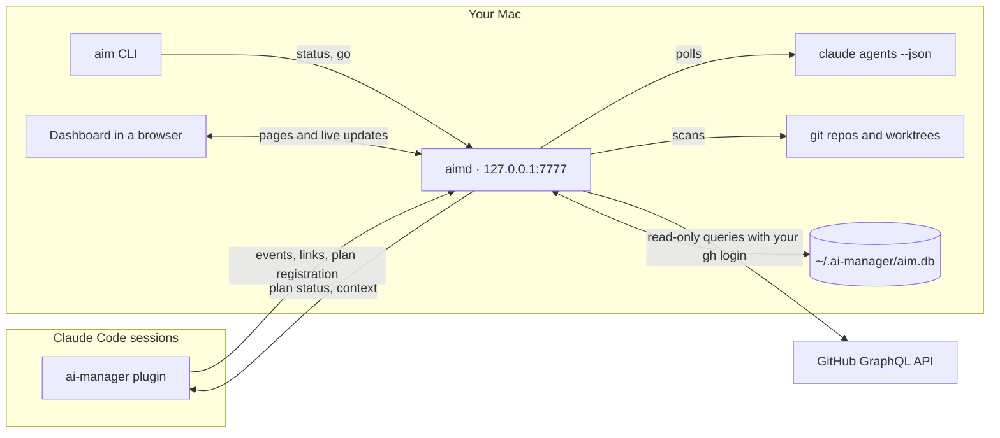

# Architecture

ai-manager runs entirely on your Mac. It has three parts:

- **aimd**, a daemon written in Go. It watches your Claude Code sessions, git worktrees and GitHub PRs, keeps what it finds in SQLite, works out each plan's board, and serves the dashboard and an HTTP API on `127.0.0.1:7777`. It runs as the launchd agent `com.gravexa.aimd`, so it starts at login and restarts if it crashes.
- **aim**, a command-line tool. It installs and stops aimd (`aim up`, `aim down`), prints a status line (`aim status`), lists and prunes worktrees (`aim ls`, `aim prune`), and brings a session to the front (`aim go`).
- **The plugin**, which loads in every Claude Code session. Its mod reports what the session does, links agents to plan packages, draws the progress line above the prompt, and adds `/aim`, `/plan-register` and the `plan_status` tool. Its skills teach Claude the plan format and how to dispatch. See [The plugin and its skills](plugin-and-skills.md).

aimd works without the plugin: it still sees every session through `claude agents --json`, and matches PRs and branches to plans by their names. The plugin adds what only a session knows: which package an agent was spawned for, and exactly what a session is waiting on.

## What aimd watches

| Source | How | How often |
|---|---|---|
| **Sessions** | `claude agents --json`, plus one `ps` snapshot to tell each session's terminal app | Every 10 s while a dashboard page is open, every 30 s otherwise, and every 60 s while the plugin is reporting, since its events carry the detail. Also soon after Claude Code's session or job files change. |
| **Plugin events** | Each session's plugin POSTs batches to `/events` | About once a second; a session that starts waiting on you is sent at once |
| **Worktrees** | Repos found under `roots` (3 levels deep) and the repos live sessions are in; `git worktree list` and `git status` in each | A full scan every 2 minutes, and a rescan of one repo when its git files change |
| **GitHub** | GraphQL queries, built from fixed templates, with tokens from `gh auth token` | See below |
| **Plan files** | Each registered plan file is watched | On every save |

**GitHub** is read with your own `gh` login, or with a personal access token file if you configure one. It answers five kinds of query:

- **the PRs of each tracked branch:** branches checked out in a worktree, or linked to a plan. Repos with something going on are asked every 60 s, the rest every 5 minutes;
- **PRs by number:** a PR the plugin saw a tool call create, merge or close, within seconds; and every 5 minutes, any PR an agent linked by URL that aimd still hasn't read (see below);
- **your open PRs** across your GitHub owners: every 60 s while a dashboard page is open, every 5 minutes otherwise;
- **PRs that ask for your review**, right after that;
- **a one-off backfill** of a repo's PRs when a plan for it is registered.

aimd tracks GitHub's rate limit. Below 1,000 points left it polls everything at the slow rate, and below 200 it stops until the limit resets.

Your owners are the `[owners]` table in `config.toml`, or else the owners of the repos aimd found.

**Which repos are on GitHub.** A repo counts when one of its remotes is on `github.com`, over `https://` or ssh (or `ssh.github.com`, GitHub's ssh host on port 443). A remote on an SSH host alias counts too when the alias points at GitHub: a remote like `github-work:owner/name.git`, with a `Host github-work` block in `~/.ssh/config` whose `HostName` is `github.com`, the usual way to use two GitHub accounts. aimd asks ssh with `ssh -G <alias>`, which prints your ssh config for that host and never connects, and keeps the answer for an hour. If ssh fails or takes over 2 seconds, the repo doesn't count as GitHub's until aimd asks again, 5 minutes later.

**PRs the plugin saw change.** When an agent creates a PR, the plugin reports its URL (`POST /api/links/pr`) and aimd stores it at once, before GitHub has been read. Until GitHub answers for it, it is shown as **not read from GitHub yet**, not as an open PR. aimd reads it by number right away. It does the same when the plugin sees `gh pr merge`, `gh pr close` or the GitHub MCP server's merge work (`POST /api/prs/refresh`). These reads are joined, at most one every 10 seconds, and what aimd stores is what GitHub answers, never the command's output. The polls stay the backstop: every 5 minutes aimd reads any linked PR it still hasn't read, so nothing depends on the plugin seeing the call.

**Repos GitHub can't read.** A repo GitHub doesn't answer for (not found, no access for your token, a PR number it has no PR for) keeps its PRs as last read. It is listed in `/api/status` under `github.unreadable`, `aim status` says "GitHub can't read owner/name", and the Overview's GitHub chip counts it.

**After each change,** aimd runs a **state pass**, at most once every 5 seconds and right after every write through the API. A state pass:

1. matches work to packages;
2. works out each package's lifecycle and badges;
3. syncs the Needs you inbox.

The inbox also syncs every 10 seconds, so snoozes and Go's delay come due on time. Pages listen on `/api/stream` (server-sent events) and refetch only the parts whose topic changed.

When something can't be read (`claude agents` times out, GitHub is down, a git command fails), aimd keeps the last good answer, marks that source stale on the Overview's health chips, and treats anything that depends on it as unknown. For cleanup, unknown always means "not safe".

## Where data lives

Everything is in `~/.ai-manager/`, or in `$AIM_HOME` when that's set. The folder is created with mode 0700.

| File | What |
|---|---|
| `aim.db` | The SQLite database (pure Go, no cgo): sessions and agents, worktrees, PRs, registered plans and their packages, links and unlinks, each package's lifecycle history, event summaries, Needs you items, dashboard settings, watched sessions and the removal log. The schema migrates itself on start. |
| `config.toml` | Optional settings: `roots`, `[owners]`, `port`, poll intervals, `[prune]`, `[notify]`, `[sessions]`. Without it, every default applies. Unknown keys are an error, so a typo doesn't silently fall back to a default. The full list is at the top of `internal/config/config.go`. |
| `token` | aimd's write token: 32 random bytes, hex, mode 0600, made on first start. aimd refuses a token file that other users can read. |
| `aimd.log` | aimd's log, rotated to `aimd.log.1` at 10 MB. |
| `aimd.launchd.log` | Under launchd, what the log can't hold: a crash, or the error aimd stopped with. |

`aim up` also writes `~/Library/LaunchAgents/com.gravexa.aimd.plist`. That file:

- holds the paths of `claude`, `gh` and `git` as your shell finds them, since launchd's `PATH` is only the system one. Run `aim up` again after moving them;
- passes through your `AIM_HOME`, `CLAUDE_CONFIG_DIR` and `GH_CONFIG_DIR`.

**Retention:**

- event summaries: 30 days (`event_retention_days`), purged daily;
- Done inbox items: 30 days by default (7, 30 or 90 on the Settings page);
- the removal log: 30 days;
- a provisional package whose work is gone: a day.

Everything else stays until you unregister its plan or delete the folder.

**In memory only, never in the database:**

- **What a session is waiting on:** the command it asks to run, the question and its options, or the plan to approve. It's kept only while the ask is pending, so an aimd restart forgets it until the session reports again.
- **Each session's terminal app**, from the last poll.
- **GitHub tokens.** They are never logged.

## Security model

aimd is built for a Mac with one user account.

- **Local only.** aimd listens on 127.0.0.1, never on the network. Every request's `Host` header must be `127.0.0.1:<port>` or `localhost:<port>`, which stops DNS rebinding. aimd sends no CORS headers, so other websites can't read its answers.
- **Writes need a secret.**
  - Programs send aimd's token in `X-AIM-Token`. The plugin has a copy in its settings.
  - The dashboard's own pages send a per-page CSRF token instead, and must be same-origin.
  - A wrong or missing token gets `401`; a bad CSRF token or another origin gets `403`.
- **Reads are open to local processes, by design.** Any program running on your Mac can read the dashboard and `GET /api/…`. That adds little on a one-account Mac: those programs run as you, and can already read the token file and Claude Code's own transcripts. The one exception is what a session is waiting on: `/api/` answers include it only for callers with the token. The dashboard's pages show it, since they're your UI.
- **Summaries only.** The plugin sends labels and short reasons, never prompts, file contents or tool output. The one exception is what a dialog waits on. That is redacted twice:
  - the plugin replaces tokens, passwords, auth headers, credentials in URLs and well-known key shapes with `[redacted]` before sending;
  - aimd applies the same rules again when it arrives.

  A secret neither recognises can still get through, so don't expose aimd beyond your Mac.
- **Strict pages.** Every response carries `Content-Security-Policy: default-src 'self'`, so pages run no inline script and load nothing from elsewhere. Responses also carry `X-Frame-Options: DENY` and `Referrer-Policy: no-referrer`. Templates escape all text, since titles, branch names and prompts are untrusted.
- **Read-only to GitHub.** The client only sends queries built from fixed templates, and refuses anything else.
- **Careful with your files.** aimd writes only in its own folder, with two exceptions:
  - **Cleanup:** removing worktrees you selected and confirmed on the dashboard, after checking each one again, never with `--force`;
  - **Go:** AppleScript to switch terminal tabs. The scripts are constants, and every value is passed as a validated argument.

  It never edits plan files.

## Code map

| Package | Does |
|---|---|
| `cmd/aimd`, `cmd/aim` | The two binaries |
| `deploy` | The launchd plist template |
| `internal/config` | `AIM_HOME`, `config.toml` and the token |
| `internal/daemon` | The scheduler: which source polls when, and the rate-limit budget |
| `internal/sessions` | `claude agents --json`, and expired background jobs |
| `internal/worktrees` | Finding repos and reading their worktrees |
| `internal/github` | The GraphQL client, tokens and the rate limit |
| `internal/live`, `internal/events` | The plugin's events: checks, redaction and live session state |
| `internal/pluginbuild` | The plugin build on disk in a plugin folder, to flag sessions on an older one |
| `internal/plans` | The plan parser (the format is in its `doc.go`) |
| `internal/state` | Matching work to packages, lifecycles, badges and alerts |
| `internal/planapi` | Registering plans, links, and the plan API's logic |
| `internal/monitor`, `internal/prwait` | Which sessions are monitored, and who a PR waits on |
| `internal/inbox`, `internal/notify` | The Needs you inbox, and macOS notifications |
| `internal/prune` | The safe-to-remove rules and removal |
| `internal/focus`, `internal/term`, `internal/osascript` | Go: finding a session's tab and switching to it |
| `internal/store` | The SQLite store and its migrations |
| `internal/web` | The HTTP server, the API and the dashboard (`APP.md` has the page conventions) |
| `plugin/` | The Claude Code plugin |

The HTTP API is documented in [`docs/api.md`](../api.md).
